# net-watch architecture

This document is the source of truth for how the core behaves. Code, tests, adapters and the README follow it; a change in behaviour starts here.

net-watch answers two questions:

1. **Is the user online?** Really online, not just "a network interface is up".
2. **How good is the connection?** Quality level, latency, throughput, and whatever the browser exposes about the link.



<sub>Source: [diagrams/architecture.html](diagrams/architecture.html)</sub>

## Package shape

One npm package, ESM only, with subpath exports generated by tsdown:

| Import | Contents | Runtime deps |
|---|---|---|
| `net-watch` | core: watcher, probe, metrics, `watchFetch`, banner | none |
| `net-watch/react` | `useNetworkStatus()` | `react` (optional peer) |
| `net-watch/vue` | `useNetworkStatus()` | `vue` (optional peer) |
| `net-watch/angular` | `injectNetworkStatus()` | `@angular/core` (optional peer) |

Move to a pnpm-workspace monorepo only when an adapter needs its own build tool (e.g. decorators needing ng-packagr) or its own version line.

## Core modules

| File | Responsibility | Exports |
|---|---|---|
| `src/watcher.ts` | Owns the state. Merges signals, decides, notifies, schedules probes and heartbeat. | `createNetworkWatcher`, `sharedWatcher`, types |
| `src/probe.ts` | One HEAD request, returns round-trip time or `null`. Knows nothing about state. | `probe` |
| `src/metrics.ts` | Smoothing, quality bands, rounding, `navigator.connection` info, Resource Timing throughput. | `ewma`, `classify`, `roundRtt`, `roundDownlink`, `connection`, `connectionInfo`, `throughputOf`, `observeThroughput` |
| `src/fetch.ts` | Wraps `fetch`, feeds outcomes into `report()`. | `watchFetch` |
| `src/banner.ts` | DOM banner for any framework. | `createBanner` |
| `src/index.ts` | Re-exports the public API. | — |

`fetch.ts` and `banner.ts` use only the watcher's public API, exactly like an adapter. The detection engine is `watcher` + `probe` + `metrics`. `probe` and `metrics` are internal and not re-exported.

## Public contract

```ts
type Quality = 'excellent' | 'good' | 'fair' | 'poor' | 'unknown'
type EffectiveType = 'slow-2g' | '2g' | '3g' | '4g'
type ConnectionType = 'bluetooth' | 'cellular' | 'ethernet' | 'wifi' | 'wimax' | 'none' | 'other' | 'unknown'
type RttBounds = readonly [excellent: number, good: number, fair: number]

interface NetworkState {
  online: boolean
  since: number                              // Date.now() of the last online/offline flip
  quality: Quality                           // every browser, from smoothed RTT
  rtt: number | undefined                    // ms, smoothed, rounded to 50; every browser once sampled
  downlink: number | undefined               // Mbps, smoothed; Chromium hint + Resource Timing
  effectiveType: EffectiveType | undefined   // Chromium only
  type: ConnectionType | undefined           // Chrome on Android / ChromeOS only
  saveData: boolean                          // Chromium only; false elsewhere
}

interface WatcherOptions {
  pingUrl?: string                           // no pingUrl → layers 1 + 2 only (see Detection)
  timeout?: number                           // probe timeout, ms. Default 5000
  maxRetryDelay?: number                     // backoff ceiling while offline, ms. Default 30000
  heartbeat?: number                         // opt-in idle probe interval, ms. Off by default; needs pingUrl
  rttBounds?: RttBounds                      // quality bands, ms. Default [150, 400, 1400]
  onOnline?: (state: NetworkState) => void
  onOffline?: (state: NetworkState) => void
}

interface NetworkWatcher {
  getState(): NetworkState                                        // same reference until something changes
  subscribe(listener: (state: NetworkState, prev: NetworkState) => void): () => void
  check(): Promise<NetworkState>                                  // force a decision now
  report(ok: boolean, rtt?: number): void                         // evidence from outside: requests, SW, native
  waitForOnline(): Promise<NetworkState>                          // resolves immediately when online
  destroy(): void                                                 // removes listeners, observers and timers
}

createNetworkWatcher(options?: WatcherOptions): NetworkWatcher
sharedWatcher(): NetworkWatcher                                    // lazy default instance for adapters
watchFetch(watcher: NetworkWatcher, baseFetch?: typeof fetch): typeof fetch
createBanner(watcher: NetworkWatcher, options?: BannerOptions): { destroy(): void }
```

State rules:

- **Immutable.** A change replaces the state object; no change keeps the same reference. `useSyncExternalStore` and every other adapter rely on this.
- **Notify on visible change only.** Listeners fire when any field changes after rounding. `rtt` is rounded to 50 ms and `downlink` to 0.1 Mbps (whole Mbps from 10 up), so a stream of similar samples causes no re-renders.
- **Unknown is `undefined`, never a guess.** A browser that does not expose a value leaves it `undefined`.
- **Order.** `onOnline` / `onOffline` run first, then listeners in subscription order.
- **SSR.** Without `window`: `online: true`, `quality: 'unknown'`, every metric `undefined`, `saveData: false`. No listeners, no timers.

Renaming or removing anything in this section is a breaking change (major version).

## Detection: online / offline



<sub>Source: [diagrams/state-machine.html](diagrams/state-machine.html)</sub>

### Three signal layers, cheapest first

| Layer | Signal | Cost | Trust |
|---|---|---|---|
| 1 | `navigator.onLine` + `online` / `offline` events | 0 requests | `false` is reliable; `true` only means an interface is up |
| 2 | Real app requests via `report()` / `watchFetch` | 0 extra requests | success proves online; a network error is only a suspicion |
| 3 | Probe: `HEAD pingUrl` | 1 request, only when needed | confirms or refutes |

### Rules

1. `offline` event or `navigator.onLine === false` → **Offline** immediately, no probe.
2. `report(true)` or a successful probe → **Online**, even if `navigator.onLine` says otherwise. Evidence beats the browser's flag.
3. **Suspect** → **Checking** (one probe). Suspects: `report(false)`, the `online` event, `visibilitychange` to visible, `pageshow` from the back/forward cache, startup.
4. Without `pingUrl`, Checking resolves at once to `navigator.onLine`, and `report(false)` is ignored because nothing can confirm it.
5. At most one probe in flight: `check()` during a probe returns the pending promise.
6. While **Offline** with `pingUrl`, retry with backoff: 2 s, doubling, capped at `maxRetryDelay`. Reset on leaving Offline; re-checked on `visibilitychange` / `pageshow` (iOS freezes timers in background tabs).
7. **Online and idle sends zero requests** unless the app opts into `heartbeat`. No fixed-interval polling by default.
8. `heartbeat` (opt-in, needs `pingUrl`): every `heartbeat` ms, probe if online and the tab is visible. It catches a connection that dies while the app is idle, and keeps `rtt` / `quality` fresh. Hidden tabs and Offline (which has its own backoff) skip it.
9. `watchFetch` never reports an aborted request (`AbortError`).

### pingUrl requirements

- Same origin, HTTPS, answers `HEAD` with `204` and `Cache-Control: no-store`, no auth.
- Excluded from any service-worker cache, or the probe always succeeds.
- HTTPS matters: a captive portal breaks TLS, so the probe fails and the user correctly sees offline.
- Third-party fallback when there is no backend: `https://www.gstatic.com/generate_204` (blocked in some regions and corporate networks; document it for users, never make it a default).

## Connection metrics

| Field | Sources | Available in |
|---|---|---|
| `rtt` | probe RTT, `report(true, rtt)` (watchFetch measures time-to-headers), `navigator.connection.rtt` | every browser once a sample exists; Chromium also has a seed at startup |
| `downlink` | Resource Timing of loaded resources, `navigator.connection.downlink` | Chromium; Firefox; Safari 16.4+ (needs `transferSize`) |
| `quality` | bands over smoothed `rtt` | every browser once a sample exists |
| `effectiveType`, `saveData` | `navigator.connection` | Chromium |
| `type` | `navigator.connection.type` | Chrome on Android / ChromeOS |

Rules:

- **Smoothing:** each metric is an EWMA, `avg = 0.7 * avg + 0.3 * sample`; the first sample seeds it. Zero from `navigator.connection` means "no estimate" and is skipped.
- **Quality bands** over smoothed RTT, default `rttBounds = [150, 400, 1400]`:

  | quality | smoothed RTT |
  |---|---|
  | `excellent` | < 150 ms |
  | `good` | < 400 ms |
  | `fair` | < 1400 ms |
  | `poor` | ≥ 1400 ms |

- **Hysteresis:** degrade as soon as a bound is crossed; improve only below 0.8 × the bound. This stops flapping at a boundary.
- **Throughput sample** from a `PerformanceResourceTiming` entry: `transferSize * 8 / (responseEnd - responseStart) / 1000` Mbps. Only entries with `transferSize >= 50 000` bytes are used, which skips cached responses, tiny responses where latency dominates, and cross-origin responses without `Timing-Allow-Origin` (they report 0). Observed with `PerformanceObserver({ type: 'resource', buffered: true })`, so page-load assets count too.
- **`navigator.connection` `change`** refreshes `effectiveType`, `type`, `saveData`, and feeds its `rtt` / `downlink` as samples.
- **Going offline** resets `quality` to `unknown` and `rtt` / `downlink` to `undefined`; samples are ignored until back online.
- Bandwidth is never measured by downloading test payloads.
- **Signal strength (Wi-Fi bars, cellular dBm) is not available to web pages** in any browser. It stays out of the contract; native apps can read it themselves.

## Browser support

Floor: **Chrome/Edge 90, Firefox 90, Safari/iOS 15**. Every platform API in core is checked against it.

| API | Chrome/Edge | Firefox | Safari/iOS | Rule in core |
|---|---|---|---|---|
| `navigator.onLine`, `online`/`offline` | ✅ | ✅ | ✅ | layer 1 |
| `visibilitychange`, `pageshow` | ✅ | ✅ | ✅ | suspect triggers; `pageshow` covers bfcache restores on iOS |
| `navigator.connection` | ✅ | ❌ | ❌ | hints only; every field falls back to `undefined` |
| `PerformanceObserver` `resource` | ✅ | ✅ | ✅ | throughput source |
| `PerformanceResourceTiming.transferSize` | ✅ | ✅ | 16.4+ | below 16.4 it reads 0, so no samples and `downlink` stays `undefined` |
| `AbortSignal.timeout` | 103+ | 100+ | 16+ | not used: `AbortController` + `setTimeout` instead |
| `fetch` HEAD, `no-cors`, `no-store` | ✅ | ✅ | ✅ | probe |
| `performance.now()` | ✅ | ✅ | ✅ | RTT |
| CSS `:where()` | 88+ | 78+ | 14+ | banner defaults with zero specificity |

Gotchas the code must handle:

- **Network-error messages differ** (`Failed to fetch` / `NetworkError when attempting to fetch resource.` / `Load failed`). Detect with `err instanceof TypeError`.
- **iOS Safari freezes JS in background tabs.** Timers stop; rely on `visibilitychange` / `pageshow` to re-check.
- **Virtual network adapters** (Docker, VPN, Hyper-V) keep `navigator.onLine === true` with Wi-Fi off. Test offline with DevTools → Network → Offline.
- **Build target `es2020`** in tsdown so syntax like `??=` is lowered for the floor.

Tests run in Vitest browser mode on Playwright `chromium`, `firefox` and `webkit`.

## Banner

`createBanner(watcher, { offlineText, onlineText, slowText?, position, hideAfter, container })`

- Offline: stays visible until back online.
- Slow: shown while `quality === 'poor'`, only when `slowText` is set. Leaving `poor` hides it at once.
- Back online: shown, then hidden after `hideAfter` ms (default 3000).
- `role="status"`; `data-state` = `offline | slow | online`, `data-position` = `top | bottom`.
- Default CSS lives under `:where(.netwatch-banner…)`, so any user rule wins without `!important`.

## Out of scope until a real need appears

- Multi-tab probe sharing (Web Locks leader + `BroadcastChannel`).
- Shipping a service worker (integrations use `report()`; see [adapters.md](adapters.md#integrations-via-report)).
- Active bandwidth tests.
