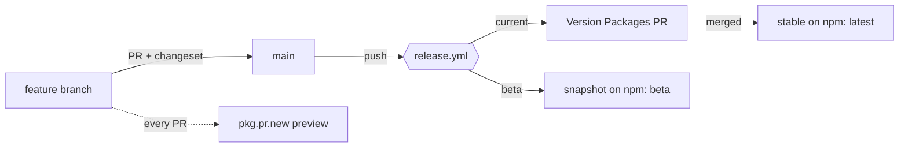

# Migrating from gitflow to the dnd-kit release flow

net-watch started with gitflow (`develop` ships betas, `main` ships stable releases; see [releasing.md](releasing.md)). This guide moves it to the flow used by [clauderic/dnd-kit](https://github.com/clauderic/dnd-kit): trunk-based, one `main` branch, betas as snapshots.

Do the migration in the order below. Phase 1 is one pull request; the rest is GitHub and npm settings.

> **Status:** Phase 1 is implemented in the pull request "ci: switch to trunk-based release" (it leaves out the optional `pkg.pr.new` workflow). Phases 2 to 4 are settings only you can change. Delete this guide after Phase 4.

## The target flow



| | gitflow (now) | dnd-kit flow (target) |
|---|---|---|
| Long-lived branches | `main`, `develop` | `main` only |
| Where PRs go | `develop` | `main` |
| Beta | Changesets pre mode: `0.x.y-beta.N`, `latest` can point at it | snapshot on every push to `main` with pending changesets: `0.x.y-beta-<timestamp>`, `latest` untouched |
| Stable | `release/*` branch, `pre exit`, PR into `main` | merge the **Version Packages** PR |
| Back-merge | `back-merge.yml` | not needed |
| Publish approval | none | optional GitHub environment `production` with a required reviewer |
| Install-from-PR | none | `pkg.pr.new` preview on every PR |

What stays the same: Changesets with a `fixed` group of the four packages, npm trusted publishing, SHA-pinned actions, `ci.yml` as the check that must pass.

## Verified on this repository

These behaviours were run against this repo before writing the steps; they are why some steps look the way they do.

| Check | Result |
|---|---|
| `changeset version --snapshot beta` while `.changeset/pre.json` is in pre mode | fails: `Snapshot release is not allowed in pre mode` → leave pre mode first |
| `changeset pre exit` then `changeset version` | all four packages become `0.1.0` |
| `changeset version --snapshot beta` with a pending patch changeset | all four become `0.1.1-beta-<yyyymmddhhmmss>` (with `snapshot.useCalculatedVersion: true`) |
| `changeset version --snapshot beta` with **no** pending changeset | exits with code 1: `No unreleased changesets found` → the workflow must check first |
| `changeset publish` flags (v3) | `--tag` and `--no-git-tag` exist; there is **no** `--snapshot` flag (dnd-kit's script uses one; ours differs) |
| Changesets in `.changeset/pre/` after `pre exit` | counted as pending (read from the `@changesets/read` source, not run end to end), so `changesets/action` should open the stable Version PR by itself; `changeset status` reports a `minor` bump for all four packages |

## Phase 0: where you start

- `main` and `develop` exist; npm has `0.1.0-beta.0` of all four packages with dist-tags `latest` **and** `beta` on it.
- `.changeset/pre.json` is in pre mode (`beta`).

## Phase 1: one PR into `main` ("ci: switch to trunk-based release")

Branch from `main`, make these changes, open the PR into `main`.

**1. Leave pre mode.**

```bash
pnpm changeset pre exit      # .changeset/pre.json becomes {"mode":"exit",...}; keep .changeset/pre/*.md
```

**2. `.changeset/config.json`:** `baseBranch` to `main`, and add the snapshot setting.

```json
{
  "baseBranch": "main",
  "snapshot": { "useCalculatedVersion": true }
}
```

(Keep the other keys: `fixed`, `access`, `ignore`, `updateInternalDependencies`.)

**3. Root `package.json` scripts:** add two next to `release`.

```json
"version-packages:beta": "changeset version --snapshot beta",
"release:beta": "pnpm build && changeset publish --tag beta --no-git-tag"
```

`--no-git-tag` keeps snapshot versions out of your git tags and GitHub Releases.

**4. Replace `.github/workflows/release.yml`.** Keep the `uses:` SHAs that are already in the file (shown here as `<sha>`; copy the same ones, do not use tags).

```yaml
name: Release

on:
  push:
    branches: [main]

concurrency:
  group: release
  cancel-in-progress: false

permissions:
  contents: read

jobs:
  release:
    name: ${{ matrix.channel }}
    if: github.repository == 'dangminhkhoi2212/net-watch'
    runs-on: ubuntu-latest
    timeout-minutes: 15
    environment: production # optional approval gate, see Phase 2
    permissions:
      contents: write # tags, GitHub releases, the version branch
      pull-requests: write # the Version Packages PR
      id-token: write # npm trusted publishing (OIDC)
    strategy:
      max-parallel: 1 # `current` first, then `beta`; each is a fresh checkout
      matrix:
        channel: [current, beta]
    steps:
      - uses: actions/checkout@<sha> # v7.0.1
        with:
          fetch-depth: 0
      - uses: pnpm/action-setup@<sha> # v6.1.0
      - uses: actions/setup-node@<sha> # v7.1.0
        with:
          node-version: 24
          registry-url: https://registry.npmjs.org
          cache: pnpm
      - run: npm install -g npm@^11.5.1 # trusted publishing needs npm >= 11.5.1
      - run: pnpm install --frozen-lockfile

      - name: Version Packages PR, or publish the stable release
        if: matrix.channel == 'current'
        uses: changesets/action@<sha> # v2.1.2
        with:
          version-script: pnpm version-packages
          publish-script: pnpm release
          commit-message: "chore: version packages"
          pr-title: "chore: version packages"
          github-token: ${{ secrets.RELEASE_TOKEN || secrets.GITHUB_TOKEN }}
        env:
          NODE_AUTH_TOKEN: ${{ secrets.NPM_TOKEN }} # optional fallback, remove once OIDC works

      - name: Publish a beta snapshot
        if: matrix.channel == 'beta'
        run: |
          # `changeset version --snapshot` exits 1 when nothing is pending (for example on the push of a version commit).
          if [ -z "$(find .changeset -maxdepth 1 -name '*.md' ! -name README.md)" ]; then
            echo "No pending changesets: nothing to snapshot"; exit 0
          fi
          pnpm version-packages:beta
          pnpm release:beta
        env:
          NODE_AUTH_TOKEN: ${{ secrets.NPM_TOKEN }} # optional fallback, remove once OIDC works
```

**5. Add `.github/workflows/continuous-release.yml`** (preview packages from every PR, like dnd-kit):

```yaml
name: Preview packages

on:
  pull_request:
  push:
    branches: [main]

permissions:
  contents: read

jobs:
  preview:
    runs-on: ubuntu-latest
    timeout-minutes: 10
    steps:
      - uses: actions/checkout@<sha> # v7.0.1
      - uses: pnpm/action-setup@<sha> # v6.1.0
      - uses: actions/setup-node@<sha> # v7.1.0
        with:
          node-version: 24
          cache: pnpm
      - run: pnpm install --frozen-lockfile
      - run: pnpm build
      - run: npx pkg-pr-new publish './packages/*'
```

It needs the pkg.pr.new GitHub App installed on the repository (Phase 2). Skip this file if you do not want previews.

**6. Remove the gitflow leftovers.**

- Delete `.github/workflows/back-merge.yml`.
- `.github/workflows/ci.yml`: change both `branches: [develop, main]` to `branches: [main]`.
- `.github/dependabot.yml`: delete the `target-branch: develop` line (Dependabot then targets `main`).

**7. Docs.**

- Rewrite `docs/releasing.md` for the new flow (the target-flow table above, "Day to day" below, one-time setup from Phase 2). Delete the sections about `develop`, `release/*`, `hotfix/*`, back-merge and pre mode.
- `AGENTS.md` line "Branches, versions, publishing to npm (gitflow, beta pre mode, CI/CD)": change to "(trunk-based, changesets, CI/CD)".
- Delete this migration guide in the same PR, or keep it as history.

**8. Check before opening the PR.**

```bash
pnpm install --frozen-lockfile && pnpm build && pnpm typecheck && pnpm test
pnpm changeset status          # needs baseBranch "main" from step 2; should list a minor bump for all four packages
```

Merge the PR (a merge commit or squash both work).

## Phase 2: GitHub and npm settings

| Where | Do |
|---|---|
| Settings → Actions → General | tick **Allow GitHub Actions to create and approve pull requests** (the Version PR needs it) |
| Settings → Branches | default branch `main`; protect it: require a PR and the `Build, typecheck, test` check |
| Settings → Environments → New | name `production`; add yourself as required reviewer. Every `release.yml` job then waits for your approval (two jobs, so two approvals per push). Skip the environment and remove the `environment:` line to publish without approval |
| npm → each package → Settings → Trusted Publisher | repository `net-watch`, workflow filename `release.yml`; set **Environment** to `production` only if you created that environment (the names must match exactly) |
| GitHub Apps | install [pkg.pr.new](https://github.com/apps/pkg-pr-new) on the repository (only for the preview workflow) |
| Secrets | once Trusted Publisher works: delete `NPM_TOKEN`, remove the two `NODE_AUTH_TOKEN` lines from `release.yml`, revoke the token on npm, then enable **Require two-factor authentication and disallow tokens** |

## Phase 3: first stable release

1. After the Phase 1 PR is merged, `release.yml` runs on `main`. The `current` job opens **chore: version packages**. It still contains the `0.1.0-beta.0` notes from `.changeset/pre/`, and bumps all four packages to `0.1.0`.
2. Review that PR; merge it. `release.yml` runs again and publishes `0.1.0` under **`latest`**. That also fixes the `latest` tag that currently points at the beta.
3. Check:

```bash
npm view @net-watch/core dist-tags    # latest: 0.1.0, beta: 0.1.0-beta.0
pnpm add @net-watch/core              # now installs 0.1.0, not a beta
```

The `beta` job skips on these pushes: there is no top-level changeset file left.

## Phase 4: clean up branches

```bash
git push origin --delete develop                 # no longer used
git push origin --delete changeset-release/main  # leftover; the action recreates it when needed
git branch -d develop 2>/dev/null
```

Delete merged feature branches the usual way. If you switched the default branch to `develop`, switch it back to `main` first (Settings → Branches), otherwise GitHub refuses to delete `develop`.

## Day to day after the migration

1. Branch from `main`, change code, add a changeset when a published package changes (`pnpm changeset`).
2. Open a PR into `main`. CI must pass; the preview bot comments with install commands.
3. Merge. If the push carries pending changesets, two things happen:
   - `current` opens or updates **chore: version packages**;
   - `beta` publishes a snapshot, for example `0.1.1-beta-20261015103824`, under the `beta` tag: `pnpm add @net-watch/core@beta`.
4. Merge **chore: version packages** when you want a stable release. It publishes under `latest` and creates git tags and GitHub Releases.

Hotfix: the same flow, nothing special (`main` is the only line).

## Rolling back

Before Phase 3: revert the Phase 1 PR and run `pnpm changeset pre enter beta` to return to pre mode. After the stable `0.1.0` is published, a prerelease of `0.1.0` would sort below it, so gitflow can be restored but the next prerelease line starts higher (for example `0.1.1-beta.0` or `0.2.0-beta.0`).

## Worth knowing

- dnd-kit publishes betas with `changeset publish --snapshot --tag beta`. Changesets v3 has no `--snapshot` flag on `publish`; the snapshot version comes from `changeset version --snapshot beta`, and `publish` only needs `--tag beta`. That is why the scripts above differ from theirs.
- dnd-kit also keeps a long-lived `experimental` branch for a second release line. net-watch does not need that.
- Every push to `main` with pending changesets publishes a new snapshot; old snapshots stay on npm. They are harmless (`latest` never points at them), but note that a `0.0.0-stage` version appeared on each package after the first publish; it was not created by anything in this repository and is not the `latest` tag.
