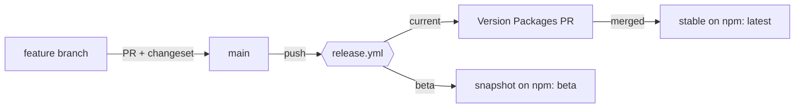

# Releasing

net-watch releases the way [dnd-kit](https://github.com/clauderic/dnd-kit) does: trunk-based, one `main` branch, stable releases through a **Version Packages** PR, betas as snapshots. Versions come from [Changesets](https://github.com/changesets/changesets); publishing to npm runs in GitHub Actions through npm **trusted publishing (OIDC)**, so there is no long-lived npm token to store and it works with two-factor authentication turned on.

The four published packages (`@net-watch/core`, `react`, `vue`, `angular`) are a fixed group: they always get the same version.

## Branches

Only `main`. Branch from it (`feature/*`, `fix/*`), open a PR into it. There is no `develop`, no release branch and no hotfix branch: a hotfix is a normal PR.

## What the workflows do

| Workflow | Trigger | Does |
|---|---|---|
| `ci.yml` | PR and push to `main` | build, typecheck and test in chromium, firefox and webkit; on PRs, fails if a published package changed without a changeset |
| `release.yml` | push to `main` | two jobs, one after the other: `current` opens or updates the **Version Packages** PR (merging it publishes the stable release under `latest` and creates git tags and GitHub Releases); `beta` publishes a snapshot under `beta` when changesets are pending |

## Day to day

1. Branch from `main`: `git switch -c feature/my-change main`.
2. Change code. If a published package changed, run `pnpm changeset`, pick the bump and describe it (commit the generated file).
3. Open a PR into `main`. CI must be green.
4. Merge. If the push carries pending changesets:
   - `current` opens or updates **chore: version packages**;
   - `beta` publishes a snapshot such as `0.1.1-beta-20261015103824` under the `beta` tag. Install it with `pnpm add @net-watch/core@beta`. Snapshots are not committed, tagged or turned into GitHub Releases, and `latest` never points at them.
5. Merge **chore: version packages** when you want a stable release. It publishes under `latest`.

Checking a release: `npm view @net-watch/core dist-tags`.

## Prereleases

Pre mode (`pnpm changeset pre enter beta`) is not used: it conflicts with snapshots (`Snapshot release is not allowed in pre mode`) and makes `latest` point at a prerelease for packages without a stable release. Use snapshots.

## One-time setup

**GitHub** (repository `dangminhkhoi2212/net-watch`, public; the workflows only run there):

- Default branch `main`.
- Settings → Actions → General → Workflow permissions: allow GitHub Actions to **create and approve pull requests** (the Version PR needs it).
- Protect `main`: require a PR, require the `Build, typecheck, test` check (and `Changeset present` on PRs), block force pushes.
- Recommended: secret `RELEASE_TOKEN` (fine-grained PAT or GitHub App token with contents and pull-requests write). PRs created with the default token do not trigger CI, so without it the Version PR has no checks: close and reopen the PR, or let an admin merge it.
- Optional approval gate: Settings → Environments → `production` (the release job uses it) → add yourself as required reviewer. Every `release.yml` job then waits for approval (two jobs, so two approvals per push). Without reviewers the jobs run straight through.

**npm** (two-factor authentication stays on):

1. The organization `net-watch` (the scope of `@net-watch/*`) must exist.
2. For **each** of the four packages: npmjs.com → package → Settings → Trusted Publisher → GitHub Actions:
   - Organization or user: `dangminhkhoi2212`
   - Repository: `net-watch`
   - Workflow filename: `release.yml` (the filename only, not the path)
   - Environment: `production` if you created reviewers for it, otherwise leave empty (the names must match exactly when set)
   - Allowed action: `npm publish`
3. Package → Settings → Publishing access → **Require two-factor authentication and disallow tokens**, once a publish through OIDC has worked (this blocks every token, including a fallback one).

`repository.url` in every `package.json` must match the GitHub repository exactly (`git+https://github.com/dangminhkhoi2212/net-watch.git`); npm checks it at publish time.

## Using an npm access token (bootstrap or fallback)

Trusted publishing (above) is the intended way. A token is only for a first publish from CI or as a temporary fallback. npm creates granular tokens **on the website only** (no CLI, no config file): npmjs.com → profile picture → **Access Tokens** → **Generate New Token**.

| Field | Value |
|---|---|
| Token name | `net-watch-ci` |
| Description | `Publish @net-watch/* from GitHub Actions` |
| Bypass two-factor authentication | **checked**: a CI job cannot answer an OTP prompt, and 2FA is on for the account |
| Allowed IP ranges | leave empty (GitHub-hosted runners have changing addresses) |
| Packages and scopes → Permissions | **Read and write (publish and stage)** |
| Packages and scopes → select | **Only select packages and scopes** → scope `@net-watch` (or the four packages once they exist) |
| Organizations → Permissions | No access (organization permissions cannot publish packages) |
| Expiration | short, for example 7 days (npm only requires at least 1 day) |

Copy the token right after it is generated; npm never shows it again. Then: GitHub → repository → Settings → Secrets and variables → Actions → New repository secret → name `NPM_TOKEN`.

Both publishing steps in `.github/workflows/release.yml` already pass the secret (`NODE_AUTH_TOKEN: ${{ secrets.NPM_TOKEN }}`); without the secret it is empty and ignored. `actions/setup-node` with `registry-url` writes the `.npmrc` that reads `NODE_AUTH_TOKEN`. npm tries OIDC first when it is configured, so the token then acts as a fallback. Delete the secret, remove the two `NODE_AUTH_TOKEN` lines and revoke the token as soon as trusted publishing works.

Limits to know: npm announced that direct publishing with granular tokens is being removed in January 2027 (stage-only tokens and `npm stage publish` remain), and from August 2026 bypass-2FA tokens can no longer perform account-identity actions. Do not build a long-term pipeline on a token. Source: https://docs.npmjs.com/about-access-tokens

## Security notes

- Every action in `.github/workflows/` is pinned to a full commit SHA with the version in a trailing comment; Dependabot (`.github/dependabot.yml`) opens weekly PRs to bump them. Never replace a SHA by a tag.
- The release jobs hold `id-token: write` (OIDC for npm) next to the version-PR logic, because `changesets/action` does both in one step. What limits the blast radius: they only run on pushes to `main`, only in `dangminhkhoi2212/net-watch`, optionally behind the `production` environment approval, and npm accepts the OIDC token only from the workflow file configured as the trusted publisher.

## Troubleshooting

- **`GitHub Actions is not permitted to create or approve pull requests`**: enable the setting in One-time setup, then re-run the failed job.
- **`E404` or `403` on publish although the package exists**: the OIDC match failed. Check the workflow filename, repository, environment name, `repository.url`, that the job has `id-token: write`, that npm is 11.5.1 or newer (the workflow upgrades it), and that no `NPM_TOKEN` is set. npm does not validate the trusted-publisher form when you save it, so mistakes only show up at publish time.
- **`EOTP`**: a token is being used instead of OIDC. Remove it from the repository secrets and from `.npmrc`.
- **A package missing from npm right after a successful publish**: the registry needs a few minutes to replicate (metadata can appear before the tarball). Query with `curl -H 'Cache-Control: no-cache' https://registry.npmjs.org/@net-watch%2fcore` before assuming failure.
- **The `beta` job is red with `No unreleased changesets found`**: the guard in `release.yml` should skip the job when no top-level `.changeset/*.md` exists; check that it was not edited.
- **Version PR never shows checks**: see `RELEASE_TOKEN` above.
- **`pnpm changeset status` fails locally with `Failed to find where HEAD diverged`**: `baseBranch` in `.changeset/config.json` is `main`; make sure a local `main` exists (`git fetch origin main:main`), or run `pnpm changeset status --since=origin/main` as CI does.
- If publishing through pnpm ever misbehaves with OIDC (pnpm 11.0.x had such a bug, fixed since), the release job's last resort is `npm publish` per package from `pnpm pack` tarballs.
