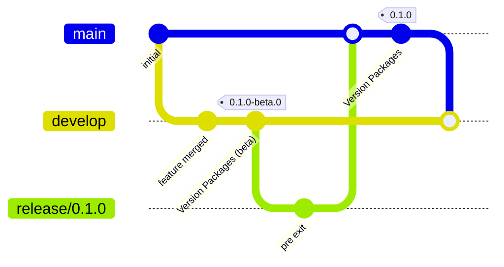

# Releasing

net-watch follows gitflow. Versions come from [Changesets](https://github.com/changesets/changesets); publishing to npm runs in GitHub Actions through npm **trusted publishing (OIDC)**, so there is no npm token to store, and it works with two-factor authentication turned on.

The four published packages (`@net-watch/core`, `react`, `vue`, `angular`) are a fixed group: they always get the same version. While the repo is in **pre mode** (`.changeset/pre.json`, tag `beta`) every release is a `x.y.z-beta.N` published under the npm dist-tag `beta`.

## Branches

| Branch | Purpose | Merges into | npm dist-tag |
|---|---|---|---|
| `develop` | integration; every merge can ship a beta | `release/*` | `beta` |
| `feature/*`, `fix/*` | one change, from `develop` | `develop` (PR) | none |
| `release/x.y.z` | stabilise a stable release, from `develop` | `main` (PR) | none |
| `main` | stable releases only | `develop` (back-merge) | `latest` |
| `hotfix/*` | urgent fix, from `main` | `main` (PR), then `develop` | `latest` |

## What the workflows do

| Workflow | Trigger | Does |
|---|---|---|
| `ci.yml` | PR and push to `develop` / `main` | build, typecheck and test in chromium, firefox and webkit; on PRs, fails if a published package changed without a changeset |
| `release.yml` | push to `develop` / `main` | opens or updates the **Version Packages** PR; when that PR is merged, publishes to npm, creates git tags and GitHub releases |
| `back-merge.yml` | push to `main` | opens a `main` → `develop` PR when develop is behind (does nothing until the `develop` branch exists) |

## Day to day

1. Branch from `develop`: `git switch -c feature/my-change develop`.
2. Change code. If a published package changed, run `pnpm changeset`, pick the bump and describe it (commit the generated file).
3. Open a PR into `develop`. CI must be green.
4. After merge, `release.yml` opens (or updates) the PR **chore: version packages (beta)**. Merge it when you want to ship: the next push publishes `0.x.y-beta.N` under the `beta` tag.

Install a beta: `pnpm add @net-watch/core@beta`.

## Stable release (leaving beta)

1. `git switch -c release/0.2.0 develop`.
2. `pnpm changeset pre exit`, commit `.changeset/pre.json`, push.
3. Open a PR `release/0.2.0` → `main`. CI must be green. Merge with a merge commit.
4. `release.yml` on `main` opens **chore: version packages**; merging it publishes the stable version under `latest`.
5. `back-merge.yml` opens `main` → `develop`. Merge it (merge commit), then on `develop` run `pnpm changeset pre enter beta` and commit, so `develop` keeps releasing betas.

## Hotfix

1. `git switch -c hotfix/fix-name main`, fix, add a changeset, PR into `main`.
2. After the Version PR is merged and published, merge the back-merge PR into `develop`.

## One-time setup

**GitHub** (repository `dangminhkhoi2212/net-watch`, public; the workflows only run there):

- Push `main` and `develop`. Make `develop` the default branch.
- Settings → Actions → General → Workflow permissions: allow GitHub Actions to **create and approve pull requests**.
- Protect `develop` and `main`: require a PR, require the `Build, typecheck, test` check (and `Changeset present` on PRs), block force pushes.
- Recommended: secret `RELEASE_TOKEN` (fine-grained PAT or GitHub App token with contents and pull-requests write). PRs created with the default token do not trigger CI, so without it the Version PR has no checks: close and reopen the PR, or let an admin merge it.

**npm** (two-factor authentication stays on):

1. Create the npm organization `net-watch` (the scope of `@net-watch/*`).
2. First publish, from your machine. The trusted publisher is configured in a package's own settings, so the package has to exist first (if the npm UI lets you add one earlier, skip this step). On `develop` run `pnpm version-packages` (gives `0.1.0-beta.0`), commit, then `pnpm release`. npm asks for your one-time password.
3. For **each** of the four packages: npmjs.com → package → Settings → Trusted Publisher → GitHub Actions:
   - Organization or user: `dangminhkhoi2212`
   - Repository: `net-watch`
   - Workflow filename: `release.yml` (the filename only, not the path)
   - Environment: leave empty
   - Allowed action: `npm publish`
4. Package → Settings → Publishing access → **Require two-factor authentication and disallow tokens**. Trusted publishers keep working; this blocks stolen tokens.

`repository.url` in every `package.json` must match the GitHub repository exactly (`git+https://github.com/dangminhkhoi2212/net-watch.git`); npm checks it at publish time.

## Using an npm access token (bootstrap or fallback)

Trusted publishing (above) is the intended way. A token is only for a first publish from CI or as a temporary fallback. npm creates granular tokens **on the website only** (no CLI, no config file): npmjs.com → profile picture → **Access Tokens** → **Generate New Token**.

| Field | Value |
|---|---|
| Token name | `net-watch-ci` |
| Description | `Publish @net-watch/* from GitHub Actions` |
| Bypass two-factor authentication | **checked**: a CI job cannot answer an OTP prompt, and 2FA is on for the account |
| Allowed IP ranges | leave empty (GitHub-hosted runners have changing addresses) |
| Packages and scopes → Permissions | **Read and write (publish and stage)** |
| Packages and scopes → select | **Only select packages and scopes** → scope `@net-watch` (or the four packages once they exist) |
| Organizations → Permissions | No access (organization permissions cannot publish packages) |
| Expiration | short, for example 7 days (npm only requires at least 1 day) |

Copy the token right after it is generated; npm never shows it again. Then: GitHub → repository → Settings → Secrets and variables → Actions → New repository secret → name `NPM_TOKEN`.

The release job already passes the secret to publishing (`NODE_AUTH_TOKEN: ${{ secrets.NPM_TOKEN }}` on the `changesets/action` step in `.github/workflows/release.yml`); without the secret it is empty and ignored. `actions/setup-node` with `registry-url` already writes the `.npmrc` that reads `NODE_AUTH_TOKEN`. npm tries OIDC first when it is configured, so the token then acts as a fallback. Delete the secret and revoke the token as soon as trusted publishing works.

Limits to know: npm announced that direct publishing with granular tokens is being removed in January 2027 (stage-only tokens and `npm stage publish` remain), and from August 2026 bypass-2FA tokens can no longer perform account-identity actions. Do not build a long-term pipeline on a token. Source: https://docs.npmjs.com/about-access-tokens

## Security notes

- Every action in `.github/workflows/` is pinned to a full commit SHA with the version in a trailing comment; Dependabot (`.github/dependabot.yml`) opens weekly PRs against `develop` to bump them. Never replace a SHA by a tag.
- The release job holds `id-token: write` (OIDC for npm) next to the version-PR logic, because `changesets/action` does both in one step. What limits the blast radius: it only runs on pushes to `develop` / `main`, only in `dangminhkhoi2212/net-watch`, and npm accepts the OIDC token only from the workflow file configured as the trusted publisher.
- Optional gate: create a GitHub environment (for example `npm-release`) with required reviewers, add `environment: npm-release` to the release job, and put the same name in each package's trusted-publisher form. Every publish then waits for your approval.

## Troubleshooting

- **`E404` or `403` on publish although the package exists**: the OIDC match failed. Check the workflow filename, repository, `repository.url`, that the job has `id-token: write`, that npm is 11.5.1 or newer (the workflow upgrades it), and that no `NPM_TOKEN` is set. npm does not validate the trusted-publisher form when you save it, so mistakes only show up at publish time.
- **`EOTP`**: a token is being used instead of OIDC. Remove it from the repository secrets and from `.npmrc`.
- **Version PR never shows checks**: see `RELEASE_TOKEN` above.
- **A new package was published to `latest` instead of `beta`**: Changesets only puts packages that were present when `pre enter` ran on the pre-release tag. Add new packages before or deliberately re-enter pre mode.
- **`pnpm changeset status` fails on a docs-only PR**: it should not; it only checks packages that changed. Make sure the PR does not touch a package directory.
- If publishing through pnpm ever misbehaves with OIDC (pnpm 11.0.x had such a bug, fixed since), the release job's last resort is `npm publish` per package from `pnpm pack` tarballs.
